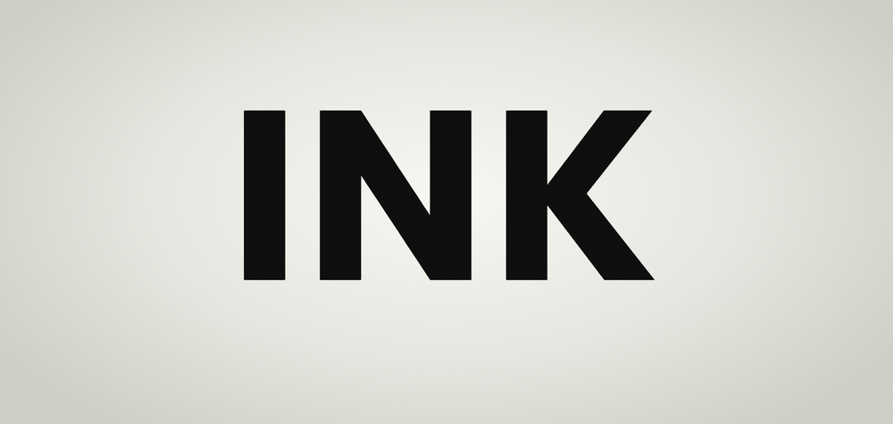

# Ink pool

<picture>
  <source media="(prefers-color-scheme: dark)" srcset="media/hero-dark.gif" />
  
</picture>

A glyph transition. Two glyphs blur into one pool of ink, a threshold keeps the edge sharp, and the next one firms up out of it.

**[Play with it →](https://ink-pool.jsfowles.com)**

It's one file, [`src/pool.ts`](src/pool.ts), with no dependencies. It draws with WebGL2.

## Quick start

Copy [`src/pool.ts`](src/pool.ts) into your project, or hit **Copy pool.ts** in the playground.

Give it an element. The CSS on that element sets the size, font and color:

```html
<div class="glyph"></div>
```

```css
.glyph {
  width: 600px; /* leave room for the ink to spread, */
  height: 500px; /* about 2× the font size wide and 1.7× tall */
  font:
    700 300px/1 "Poppins",
    sans-serif;
  color: #111;
}
```

Then show it something:

```ts
import { inkPool, DEFAULTS } from "./pool";

const pool = inkPool(document.querySelector<HTMLElement>(".glyph")!, DEFAULTS);

pool.show("A");
pool.show("B"); // A pools into B
```

That's it. The rest is optional.

## Recipes

### Cycle through words

```ts
const words = ["INK", "POOL", "MELT"];
let i = 0;
pool.show(words[0]);
setInterval(() => pool.show(words[++i % words.length]), 2500);
```

Keep the interval longer than `duration` (950ms) so each one gets a moment to sit.

### Your own settings

Tune it in the playground, open **Settings** and hit **Copy settings**. You only get what you changed:

```ts
const pool = inkPool(el, { ...DEFAULTS, spread: 0.1, sink: 12 });
```

`pool.set()` changes them later, even mid-morph.

### Sentences

```ts
pool.show("Ink runs into ink");
```

Long text wraps and shrinks to fit, and the effect scales down with it. Give paragraphs time to be read before you swap them.

### Freeze it

```ts
pool.hold("pooled"); // stops at the goopy middle
pool.hold(null); // lets it finish
```

The stops are `start`, `melting`, `pooled`, `forming` and `settled`, or any number from 0 to 1.

### Dark mode

The ink is the element's `color`. If that changes, call `pool.set(DEFAULTS)` (or your settings) so it notices.

### Shapes

Pass `draw` to draw anything. Draw it in any color, the pool inks it.

```ts
import { inkPool, DEFAULTS, type Draw } from "./pool";

const draw: Draw = (ctx, key, { width, height, size }) => {
  ctx.beginPath();
  ctx.arc(
    width / 2,
    height / 2,
    size * (key === "big" ? 0.45 : 0.2),
    0,
    Math.PI * 2,
  );
  ctx.fill();
};

const pool = inkPool(el, DEFAULTS, { draw });
pool.show("small");
pool.show("big");
```

If you draw something smaller than `size`, return how much smaller (`0.5`, say) and the effect scales to match.

### React

```tsx
import { useEffect, useRef } from "react";
import { inkPool, DEFAULTS } from "./pool";

export const InkGlyph = ({ text }: { text: string }) => {
  const el = useRef<HTMLDivElement>(null);
  const pool = useRef<ReturnType<typeof inkPool> | null>(null);

  useEffect(() => {
    pool.current = inkPool(el.current!, DEFAULTS);
    return () => pool.current?.teardown();
  }, []);

  useEffect(() => pool.current?.show(text), [text]);

  return <div ref={el} className="glyph" role="img" aria-label={text} />;
};
```

Same idea anywhere else: make it once, `show` when it changes, `teardown` when it goes away.

## API

| Call                             | Does                                                       |
| -------------------------------- | ---------------------------------------------------------- |
| `inkPool(el, settings, options)` | Starts a pool in `el`. Both after `el` are optional.       |
| `pool.show(glyph)`               | Shows a glyph. If one's still morphing, it waits its turn. |
| `pool.show(glyph, { replace })`  | Skips the line: it starts now, and anything waiting goes.  |
| `pool.hold(stop)`                | Freezes it at a stop. `null` lets go.                      |
| `pool.set(settings)`             | New settings, and it rereads the color.                    |
| `pool.teardown()`                | Stops it and removes the canvas.                           |

Options: `draw` (above), `queue` (how many glyphs can wait, `3` by default), and `onPhase` / `onProgress` if you want to follow along.

## Settings

| Setting     | Default | Range      | Does                                        |
| ----------- | ------- | ---------- | ------------------------------------------- |
| `duration`  | `950`   | 150–3000ms | How long a morph takes.                     |
| `spread`    | `0.05`  | 0–0.15em   | How far the ink spreads.                    |
| `sink`      | `7`     | 0–30%      | How far the old glyph drops on the way out. |
| `rise`      | `4`     | 0–30%      | How far above its spot the new one starts.  |
| `hardness`  | `24`    | 1–60       | How sharp the edge is. Low gets smoky.      |
| `threshold` | `0.42`  | 0.1–0.9    | Where the edge falls. Lower is bolder.      |
| `rest`      | `0`     | 0–0.04em   | Blur when it's sitting still.               |
| `opacity`   | `1`     | 0.02–1     | Overall opacity.                            |
| `fadeStart` | `100`   | 0–100%     | Fades out downward from here. `100` is off. |
| `fadeEnd`   | `100`   | 0–100%     | Gone by here.                               |
| `breathe`   | `0`     | 0–6s       | A slow pulse at rest. `0` is off.           |

The playground's presets are good starting points: **Glass** (the defaults), **Backdrop** (faint, fading, breathing, for behind copy), **Syrup** (slow and heavy), **Snap** (barely pools), **Mercury** (hard beads) and **Smoke** (soft and drifty).

## Good to know

- Reduced motion is handled for you. Glyphs just swap.
- The canvas is hidden from screen readers, so label the element.
- No WebGL2? It still shows the glyph, it just won't morph.
- It only draws while something's moving.
- Cut a morph short and the next picks up the pool where it is, so it never jumps.
- I've mostly tested it in Chrome. Safari and Firefox should be fine, but check.

## The playground

```bash
npm install
npm run dev
```

It's an Astro page. Press a key to write it, or use the arrow keys to step through a set. `npm run check` typechecks and formats. The effect is `src/pool.ts`, everything else is the playground.

## License

MIT. Poppins and DM Mono are under the SIL Open Font License.
