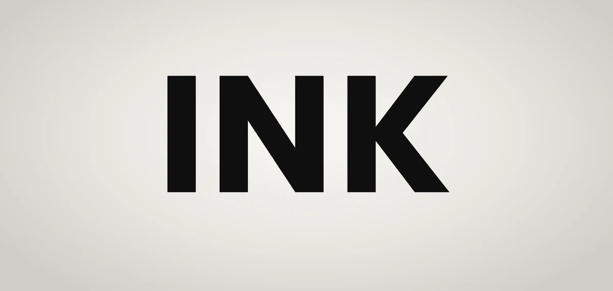

<div align="center">

<picture>
  <source media="(prefers-color-scheme: dark)" srcset="media/hero-dark.webp" />
  
</picture>

# Ink pool

A glyph transition. Two glyphs blur into one pool of ink, a threshold keeps the edge sharp, and the next one firms up out of it.

**[Play with it](https://ink-pool.jsfowles.com)** · [Quick start](#quick-start) · [API](#api) · [Settings](#settings)

<sub>One file, <a href="src/pool.ts"><code>src/pool.ts</code></a>. No dependencies. WebGL2.</sub>

</div>

## Quick start

Copy [`src/pool.ts`](src/pool.ts) into your project.

> [!TIP]
> Or hit **Copy pool.ts** in the playground, and **Copy settings** for the feel you tuned there.

Give it an element. The CSS on that element sets the size, font and color:

```html
<div class="glyph"></div>
```

```css
.glyph {
  width: 600px; /* leave room for the ink to spread, */
  height: 500px; /* about 2× the font size wide and 1.7× tall */
  font:
    700 300px/1 "Poppins",
    sans-serif;
  color: #111;
}
```

Then show it something:

```ts
import { inkPool } from "./pool";

const pool = inkPool(document.querySelector<HTMLElement>(".glyph")!);

pool.show("A"); // the first glyph just appears
pool.show("B"); // A pools into B
```

That's it. The rest is optional.

## Recipes

### Cycle through words

```ts
const words = ["INK", "POOL", "MELT"];
const sleep = (ms: number) => new Promise((done) => setTimeout(done, ms));

for (let i = 0; ; i++) {
  await pool.show(words[i % words.length]);
  await sleep(1500);
}
```

`show` resolves once its glyph settles, so each word sits for 1.5s however long its morph took. It resolves `false` if something replaced the glyph first.

### Your own settings

Tune it in the playground, open **Settings** and hit **Copy settings**. You only get what you changed:

```ts
const pool = inkPool(el, { spread: 0.1, sink: 12 });
```

`pool.set()` changes them later, even mid-morph. Pass only what changes. It eases there over half a second; `{ ease: 0 }` snaps, for a slider mid-drag, and `{ ease: 900 }` takes longer.

```ts
pool.set({ hardness: 8 });
```

### Sentences

```ts
pool.show("Ink runs into ink");
```

Long text wraps and shrinks to fit, and the effect scales down with it. Give paragraphs time to be read before you swap them.

If something sits over part of the element, say where the text may go. `room` is read each time a glyph shows, in px down the element:

```ts
const pool = inkPool(el, {}, { room: () => ({ top: 80, bottom: 420 }) });
```

### Freeze it

```ts
pool.hold("pooled"); // stops at the goopy middle
pool.hold(null); // lets it finish
```

The stops are `start`, `melting`, `pooled`, `forming` and `settled`, or any number from 0 to 1.

### Dark mode

The ink is the element's `color`, and the pool notices when it changes. Nothing to call.

<details>
<summary><b>Shapes</b></summary>

Pass `draw` to draw anything. Draw it in any color, the pool inks it.

```ts
import { inkPool, type Draw } from "./pool";

const draw: Draw = (ctx, key, { width, height, size }) => {
  ctx.beginPath();
  ctx.arc(
    width / 2,
    height / 2,
    size * (key === "big" ? 0.45 : 0.2),
    0,
    Math.PI * 2,
  );
  ctx.fill();
};

const pool = inkPool(el, {}, { draw });
pool.show("small");
pool.show("big");
```

If you draw something smaller than `size`, return how much smaller (`0.5`, say) and the effect scales to match.

</details>

<details>
<summary><b>React</b></summary>

```tsx
import { useEffect, useRef } from "react";
import { inkPool, type Pool } from "./pool";

export const InkGlyph = ({ text }: { text: string }) => {
  const el = useRef<HTMLDivElement>(null);
  const pool = useRef<Pool | null>(null);

  useEffect(() => {
    pool.current = inkPool(el.current!);
    return () => pool.current?.teardown();
  }, []);

  useEffect(() => {
    pool.current?.show(text);
  }, [text]);

  return <div ref={el} className="glyph" role="img" aria-label={text} />;
};
```

Same idea anywhere else: make it once, `show` when it changes, `teardown` when it goes away.

</details>

## API

| Call                             | Does                                                                     |
| -------------------------------- | ------------------------------------------------------------------------ |
| `inkPool(el, settings, options)` | Starts a pool in `el`. Both after `el` are optional.                     |
| `pool.show(glyph)`               | Shows a glyph, after any still morphing. Resolves when it settles.       |
| `pool.show(glyph, { replace })`  | Skips the line: it starts now, and anything waiting goes.                |
| `pool.hold(stop)`                | Freezes it at a stop. `null` lets go.                                    |
| `pool.set(settings, { ease })`   | Eases to new settings, only the ones you pass. `ease` is in ms, 0 snaps. |
| `pool.teardown()`                | Stops it and removes the canvas.                                         |

Options: `draw` (above), `queue` (how many glyphs can wait, `3` by default; `0` cuts a morph short instead), `room` (above), and `onPhase` / `onProgress` to follow along while it moves.

## Settings

| Setting     | Default | Range      | Does                                        |
| ----------- | ------- | ---------- | ------------------------------------------- |
| `duration`  | `950`   | 150–3000ms | How long a morph takes.                     |
| `spread`    | `0.05`  | 0–0.15em   | How far the ink spreads.                    |
| `sink`      | `7`     | 0–30%      | How far the old glyph drops on the way out. |
| `rise`      | `4`     | 0–30%      | How far above its spot the new one starts.  |
| `hardness`  | `24`    | 1–60       | How sharp the edge is. Low gets smoky.      |
| `threshold` | `0.42`  | 0.1–0.9    | Where the edge falls. Lower is bolder.      |
| `rest`      | `0`     | 0–0.04em   | Blur when it's sitting still.               |
| `opacity`   | `1`     | 0.02–1     | Overall opacity.                            |
| `fadeStart` | `100`   | 0–100%     | Fades out downward from here. `100` is off. |
| `fadeEnd`   | `100`   | 0–100%     | Gone by here.                               |
| `breathe`   | `0`     | 0–6s       | A slow pulse at rest. `0` is off.           |

The playground's presets are good starting points: **Glass** (the defaults), **Backdrop** (faint, fading, breathing, for behind copy), **Syrup** (slow and heavy), **Snap** (barely pools), **Mercury** (hard beads) and **Smoke** (soft and drifty).

## Good to know

- Reduced motion is handled for you. Glyphs just swap.
- The canvas is hidden from screen readers, so label the element.
- No WebGL2? It still shows the glyph, it just won't morph.
- It only draws while something's moving.
- Cut a morph short and the next picks up the pool where it is, so it never jumps.
- Agents can read [llms.txt](https://ink-pool.jsfowles.com/llms.txt), with the README and the source of `pool.ts` in one file at [llms-full.txt](https://ink-pool.jsfowles.com/llms-full.txt).

> [!NOTE]
> I've mostly tested it in Chrome. Safari and Firefox should be fine, but check.

## The playground

```bash
npm install
npm run dev
```

It's an Astro page. Press any key to write it, or <kbd>←</kbd> <kbd>→</kbd> to step through a set. `npm run check` typechecks and formats, and `npm test` steps the morph timeline on a fake clock. The effect is `src/pool.ts`, everything else is the playground.

## License

MIT. Poppins and DM Mono are under the SIL Open Font License.
